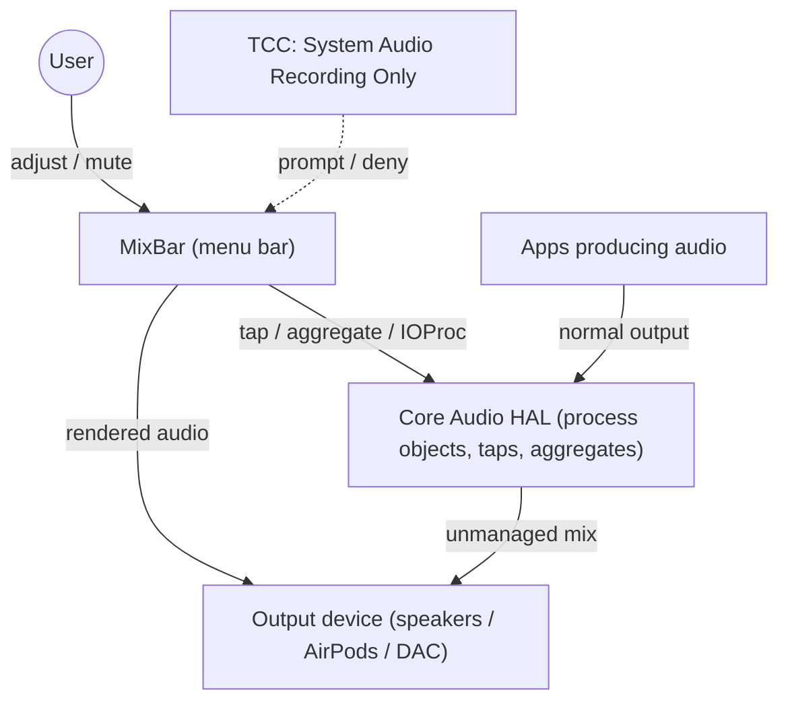
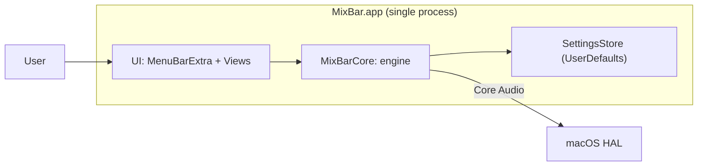
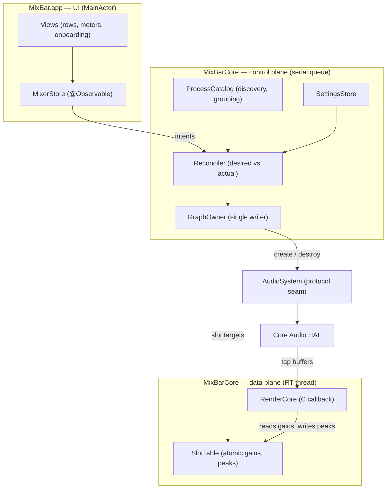
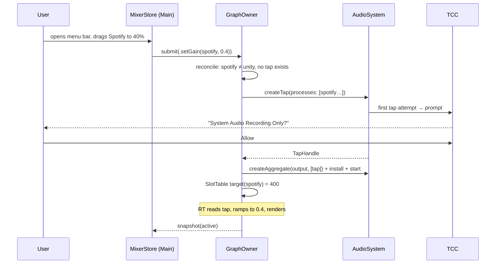
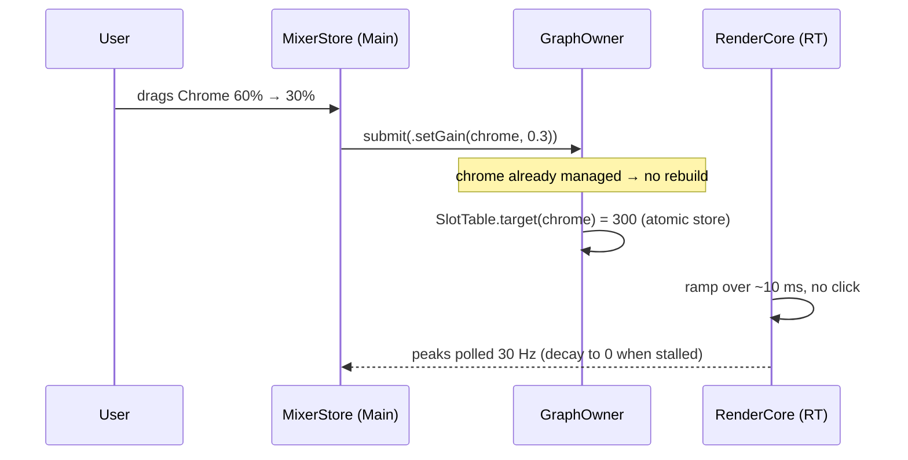
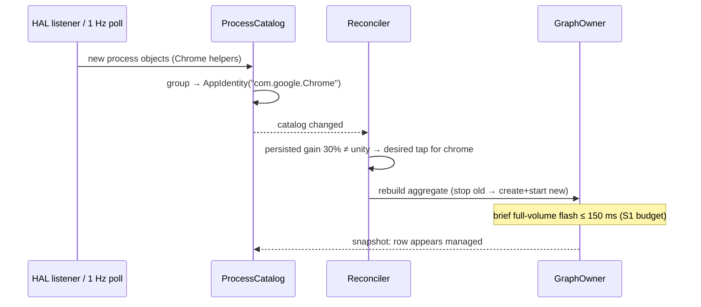
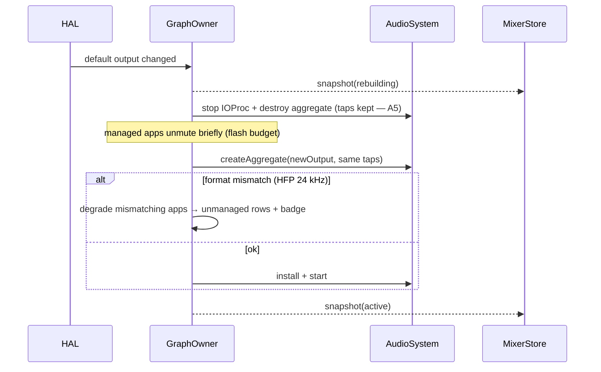
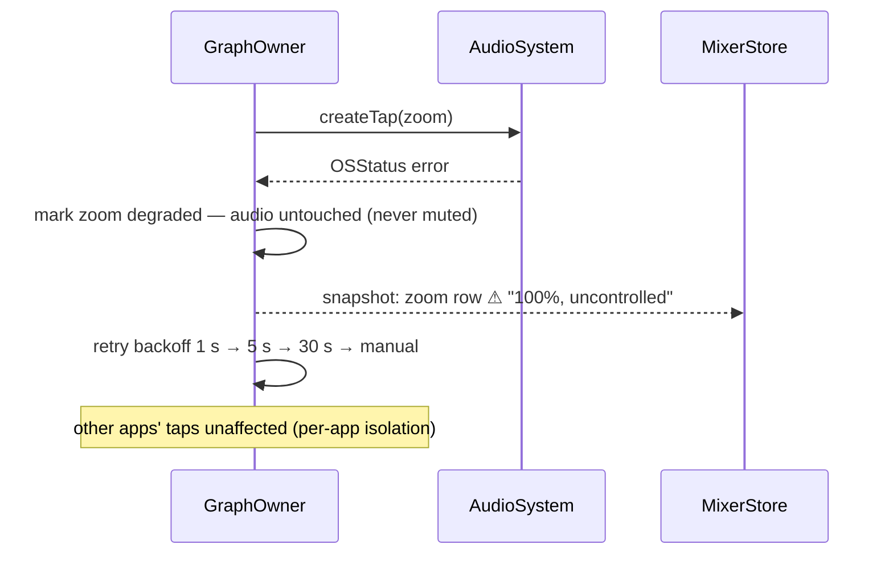
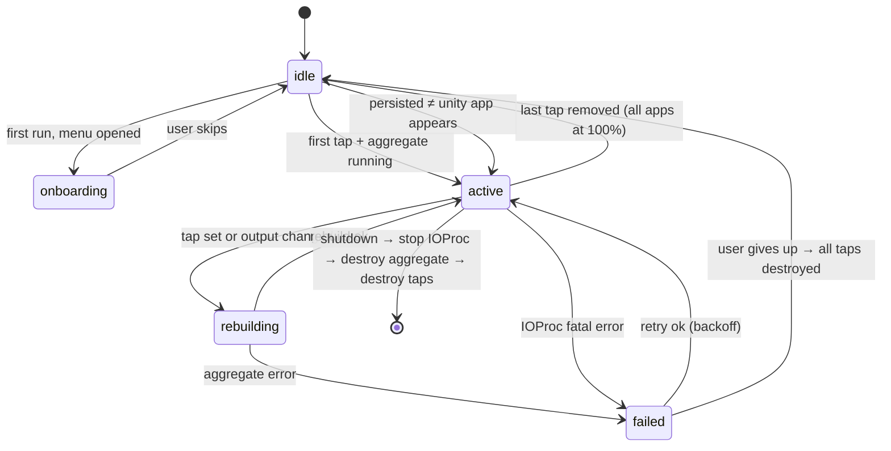
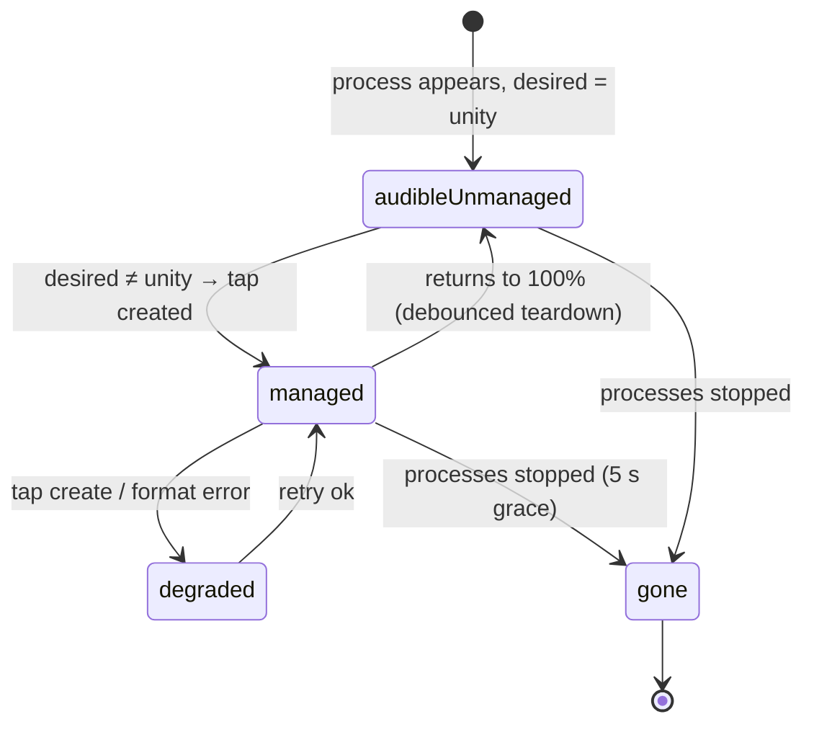

# MixBar — Architecture Document

**Status:** Proposed · **Date:** 2026-10-19 · **Updated:** 2026-10-20 · **Minimum macOS:** 14.2 (ADR-008) · **Scope:** MVP · **Implementation:** walking skeleton complete (see README)

MixBar is a menu-bar per-app volume mixer for macOS: it lists every application currently producing audio and gives each an independent volume and mute — with no audio driver, no admin rights, no kext, and without ever becoming the system output device.

---

## 1. Executive Summary

Core mechanism: for each app the user adjusts, MixBar creates a Core Audio process tap (`CATapDescription` with `muteBehavior = .mutedWhenTapped`) inside one private aggregate device built on the current default output. A single real-time IOProc reads all tap buffers, applies per-app gain from a preallocated atomic slot table, mixes, and writes to the output. Apps left at 100% are never tapped — bit-perfect, zero overhead.

Control plane is a desired-state reconciler running on a single-writer queue; the UI observes immutable snapshots. Every failure path — crash, permission denial, aggregate failure, device change — ends in taps being torn down or never created, which automatically restores normal audio (`mutedWhenTapped` mutes only while the tap is being read).

**The invariant: degrade to "no per-app control", never to silence.**

Five decisions define the system:

| ADR | Decision |
|---|---|
| 001 | Single private aggregate containing all taps + the output device |
| 002 | Tap on demand only (apps whose desired state ≠ 100%) |
| 003 | App grouping via public APIs (bundle ID + parent chain) |
| 004 | Single-writer graph owner + atomic slot table for the RT path |
| 005 | Permission UX without preflight: first adjustment triggers the prompt |

---

## 2. Assumptions & Open Questions

Assumptions, each validated by a Week-0 spike (§15):

| # | Assumption | Spike |
|---|---|---|
| A1 | An aggregate's tap list cannot be mutated after creation; changing the tap set requires a rebuild | S1, S2 |
| A2 | Multiple private aggregates may reference the same output device (validates fallback topology B) | S2 |
| A3 | No public API preflights "System Audio Recording Only"; the only trigger is attempting a tap | S3 |
| A4 | Under AirPods HFP the output runs 24 kHz mono while taps may deliver 48 kHz; the single aggregate either converts or fails | S4 |
| A5 | A tap created without a specific deviceUID follows its process across output-device changes; only the aggregate is rebuilt | S4 |
| A6 | `kAudioProcessPropertyIsRunningOutput` + property listeners + a 1 Hz poll suffice for row liveness | S1 |

Open questions (non-blocking, phase 2):

- Can two aggregates read the same tap simultaneously? (Would enable seamless rebuild.)
- Exact TCC re-prompt semantics when the binary is re-signed with the same identity.

---

## 3. Architecture Overview (C4)

### 3.1 System context



### 3.2 Containers

Single process, single app bundle:



### 3.3 Components



---

## 4. Architecture Decision Records

### ADR-001: Audio graph topology — single private aggregate

**Context.** Per-app gain requires taps (`mutedWhenTapped`) and an aggregate that a real-time IOProc can read and write.

**Options.**

| Criterion | A: one aggregate, all taps + output | B: one aggregate per app | C: tap-only aggregates + separate playback |
|---|---|---|---|
| Added latency (managed apps) | ~5–15 ms, single clock | ~5–15 ms per app | ~20–40 ms, two clocks + resampler |
| CPU | one IOProc | N IOProcs | N + 1 IOProcs + resampling |
| Add/remove a tap | full rebuild → brief flash for all managed apps | rebuild only that app | rebuild only that app |
| Buffer→tap mapping | verified once (S2) | trivial (1:1) | trivial |
| AirPods HFP 24 kHz | single rate domain; taps may diverge → degrade per app (S4) | same, per app | immune, but needs drift handling |
| Output switch | one rebuild | N rebuilds | playback rebuild only |
| Phase-2 routing fit | poor | good | good |

**Decision.** Option A for MVP.

**Consequences.** One IOProc, one clock, no resampler in the RT path — the simplest safe RT design. The cost is the rebuild flash when the tap set changes (bounded, user-initiated). **Fallback:** B, if S1/S2 shows the rebuild breaks audio or the flash exceeds 150 ms. B is also the natural target for phase-2 routing, so the `GraphBuilder` seam keeps that migration local.

### ADR-002: Taps on demand only

**Context.** Should every audible app be tapped always, or only apps whose desired gain ≠ 100% / muted?

**Decision.** Create a tap only when the desired state for that app differs from unity; tear down (debounced 300 ms) when it returns to unity.

**Consequences.** Unmanaged apps are bit-perfect with zero added latency and zero CPU — a product promise. First adjustment of an app pays one aggregate rebuild. Dragging a slider never rebuilds (gain-only atomic writes); only crossing the 100% boundary does. **Rejected alternative** (tap everything): spends CPU and adds latency to apps the user never touches, and makes "unadjusted = untouched" untestable.

### ADR-003: App identity via public APIs

**Context.** A row is one user-facing app, not one process (Electron renderers, browser helpers, audio-service subprocesses).

**Decision.** Grouping key = canonical bundle ID:

1. `NSRunningApplication(processIdentifier:)` → `bundleIdentifier`.
2. If nil, or the bundle ID matches a known helper pattern (`*Helper*`, `*helper*`, `*Renderer*`), walk the parent PID chain (sysctl `kinfo_proc` `p_ppid`) until an `NSRunningApplication` with a regular, non-agent app is found.
3. System daemons without a resolvable owning app are hidden.
4. Pro-audio hosts (Logic, Ableton, Pro Tools) and known system audio helpers are excluded by an editable bundle-ID list.
5. Ambiguous grouping → one row per resolved top app; ambiguity never blocks audio.

`responsibility_get_pid_responsible_for_pid` (private API) is **not** in the core path: phase-2 optional flag with automatic fallback to the parent-chain walk, ADR'd separately.

**Consequences.** Public APIs only. Grouping can mis-merge unusual apps (acceptable: a mis-grouped row still controls its processes' gain). Browser tabs share one row (documented limitation: per-app means per audio process group).

### ADR-004: Concurrency — single-writer graph, atomic slot table

**Context.** Core Audio calls block; the RT thread must be lock-free; the UI must stay responsive.

**Decision.**

- **Control plane:** `GraphOwner`, a dedicated serial `DispatchQueue` (QoS `.userInitiated`). All tap/aggregate/IOProc creation and destruction happens there, in a strict order: stop IOProc → destroy aggregate → destroy tap. HAL property-listener callbacks hop to this queue. `MixerStore` (MainActor) submits intents; the reconciler is idempotent and re-runs on every state change.
- **Data plane:** the IOProc is a C function pointer over a preallocated, fixed-capacity slot table (`cat_slot_t` from the vendored `CAtomic` C11 shim). Gains are `_Atomic uint16_t` (thousandths), peaks published as `_Atomic uint32_t` float bit patterns, ramps computed in RT over ~10 ms. No allocation, no locks, no ObjC/Swift messages, no logging on the RT thread.
- **UI:** observes immutable `MixerSnapshot` values; meters poll peaks at 30 Hz with decay to zero (a stalled RT shows an honest zero, not a frozen bar).

**Consequences.** One writer + idempotent reconcile = crash-safe at any interleaving (anything half-built is reconciled on the next pass). The only shared mutable state between planes is the slot table, which is wait-free. **Zero third-party dependencies:** atomics are a vendored C11 shim (`CAtomic`) — native RT-grade primitives, no package fetch, no hand-rolled Swift atomics. **Rejected:** actors for graph ownership (blocking Core Audio calls would stall the cooperative pool); locks in RT (priority inversion).

### ADR-005: Permission model without preflight

**Context.** Taps return digital silence when "System Audio Recording Only" is denied; no public API reports the status.

**Decision.** Onboarding before the first tap: explain the permission, then the user's first adjustment *is* the trigger — the TCC prompt appears contextually. Detection heuristic: if every managed tap reads absolute silence for ≥ 2 s while ≥ 1 tapped process reports `IsRunningOutput`, show a dismissible banner with a button that opens Privacy & Security and a Retry that recreates the taps (re-triggering the prompt).

**Consequences.** No private `TCCAccessPreflight` in the core path. The heuristic can false-positive only when all managed apps are simultaneously silent-but-running — and it only shows a banner, it never disables audio. Known limitation: DRM audio is silent per-tap while others play, hence the "all taps zero" condition.

### ADR-006: Persistence — UserDefaults, bundle-ID keyed

`AppSetting { bundleID, gain, muted, remember }`, JSON in UserDefaults, schema versioned, writes debounced 500 ms. **Rejected** SwiftData: ≤ a few hundred rows, no queries beyond keyed lookup.

### ADR-007: Distribution — Developer ID, notarized, no sandbox

Hardened runtime, no sandbox (incompatible with process taps), no App Store. Stable Developer ID signing for *dev* builds too — TCC is tied to the code signature, so ad-hoc signing causes permission churn. Notarization via `notarytool`. arm64 only for MVP. Sparkle: phase 2.

### ADR-008: Minimum macOS 14.2

Process taps shipped in 14.2. Everything else used (`MenuBarExtra`, `SMAppService`, `os.Logger`) is 13/14-era. A 15.0 floor buys nothing this design needs; re-evaluate if spikes hit 15-only APIs.

---

## 5. Module Map

| Module | Responsibility | May depend on | Must not |
|---|---|---|---|
| `Render` | RT mixing: slot table, ramps, clamp, peaks | Darwin, CoreAudio types, CAtomic | everything else |
| `AudioSystem` | protocol seam + `CoreAudioSystem` impl | CoreAudio, AudioToolbox, os.Logger | UI, store, reconciler |
| `Graph` | GraphOwner, GraphBuilder, tap/aggregate lifecycle | AudioSystem, Render, Model | SwiftUI/AppKit |
| `Discovery` | process catalog, identity/grouping, exclusions | AudioSystem, Model | Graph internals |
| `Reconciler` | desired vs actual, intents | Graph, Discovery, Persistence, Model | Core Audio direct calls |
| `Persistence` | settings store | Foundation | — |
| `Model` | Snapshot, AppRow, AppSetting, EngineState | Foundation | everything above |
| `MixBar` (app) | menu bar UI, onboarding, settings | Model, MixerStore | Core Audio direct calls |

---

## 6. Repository Layout

```
MixBar/
├── ARCHITECTURE.md
├── README.md
├── Package.swift                    # SwiftPM: CAtomic, MixBarCore, MixBarApp, tests
├── Sources/
│   ├── CAtomic/                     # vendored C11 atomics shim (RT path)
│   ├── MixBarCore/
│   │   ├── Model/                   # AppIdentity, AppRow, EngineState, MixerIntent…
│   │   ├── Render/                  # RenderCore, RenderContext (no UI, no Foundation)
│   │   ├── AudioSystem/             # protocol seam, CoreAudioSystem, FakeAudioSystem
│   │   ├── Graph/                   # GraphOwner (single writer)
│   │   ├── Discovery/               # ProcessCatalog, grouping, exclusions
│   │   ├── Reconciler/              # pure desired-state planner
│   │   └── Persistence/             # SettingsStore
│   └── MixBarApp/                   # SwiftUI menu bar UI
├── Tests/MixBarTests/               # render math, reconciler, settings, e2e
├── AppResources/Info.plist          # LSUIElement, NSAudioCaptureUsageDescription
├── Scripts/                         # build-app.sh, check-deps.sh
└── Spikes/                          # S1–S4 (Week 0, throwaway)
```

---

## 7. Key Swift Interfaces

Signatures only; implementation is out of scope for this document.

```swift
// Model/
struct AppIdentity: Hashable, Sendable { var canonicalBundleID: String }

enum AppRowState: Sendable {
    case unmanaged        // desired = unity, no tap
    case managed          // tap live
    case degraded(reason: DegradedReason)  // tap failed / format unsupported; audio untouched
    case gone
}

struct AppRow: Identifiable, Sendable {
    let identity: AppIdentity
    let displayName: String
    let isAudible: Bool
    let rowState: AppRowState
    var gain: Float        // desired 0...1 — what the slider shows
    var muted: Bool
    var id: AppIdentity { identity }
}

struct MixerSnapshot: Sendable, Equatable {
    let engine: EngineState
    let rows: [AppRow]
    let outputDeviceName: String?
    let permissionBanner: Bool
}

enum EngineState: Sendable, Equatable {
    case idle              // no managed apps, nothing tapped
    case onboarding
    case active            // aggregate + IOProc running, ≥ 1 tap
    case rebuilding        // tap set or output changing
    case failed(reason: EngineFailure)   // all taps torn down, audio untouched
}

enum MixerIntent: Sendable {
    case setGain(AppIdentity, Float)     // 0...1
    case setMuted(AppIdentity, Bool)
    case setAllAppsGain(Float)
    case retryPermission
    case shutdown
}
```

```swift
// AudioSystem/ — the only type that calls Core Audio
protocol AudioSystem: Sendable {
    func processObjectIDs() throws -> [AudioObjectID]
    func pid(of process: AudioObjectID) throws -> pid_t
    func bundleID(of process: AudioObjectID) throws -> String?
    func isRunningOutput(_ process: AudioObjectID) throws -> Bool
    func defaultOutputDevice() throws -> AudioObjectID
    func deviceName(_ device: AudioObjectID) throws -> String
    func setProcessListener(_ handler: @Sendable @escaping () -> Void) throws
    func setDefaultDeviceListener(_ handler: @Sendable @escaping () -> Void) throws

    // stereoMixdown, mutedWhenTapped, private tap
    func createTap(processes: [AudioObjectID]) throws -> TapHandle
    func destroyTap(_ handle: TapHandle) throws
    func tapFormat(_ handle: TapHandle) throws -> AudioStreamBasicDescription

    // private aggregate, output as main subdevice,
    // kAudioSubTapDriftCompensationKey = true, TapAutoStart
    func createAggregate(output: AudioObjectID, taps: [TapHandle]) throws -> AggregateHandle
    func destroyAggregate(_ handle: AggregateHandle) throws

    func installRenderLoop(on aggregate: AggregateHandle,
                           context: UnsafeMutablePointer<RenderContext>) throws
    func startRenderLoop(on aggregate: AggregateHandle) throws
    func stopRenderLoop(on aggregate: AggregateHandle) throws
}
```

```c
// CAtomic (C11): state shared with the RT path, accessed via exported helpers.
typedef struct {
    _Atomic uint16_t target_milli;  // 0...1000, control plane writes
    uint32_t current_milli;         // ramp state, RT only
    float peak;                     // per-call peak, RT only
    _Atomic uint32_t peak_shared;   // published peak (float bits), UI reads
} cat_slot_t;

typedef struct { _Atomic uint32_t value; } cat_flag_t;  // current tap count
```

```swift
// Render/ — data plane. No allocations after setup.
// The IOProc is AudioDeviceIOProc (C function pointer); S1 pins it.
public struct RenderContext {
    let slots: UnsafeMutablePointer<cat_slot_t>
    let capacity: Int                                  // allocation bound (max slots)
    let activeSlots: UnsafeMutablePointer<cat_flag_t>  // current tap count
    let rampFrames: UInt32                             // ~10 ms of gain ramp
    var frameRate: Float64
    var outputChannels: Int
}

enum RenderCore {
    // Pure function over buffers: read taps, ramp gains, mix, clamp, publish
    // peaks. Frame count is derived from mDataByteSize (AudioDeviceIOProc does
    // not pass it). Any unexpected buffer layout renders digital silence.
    static func render(_ ctx: UnsafePointer<RenderContext>,
                       input: UnsafePointer<AudioBufferList>,
                       output: UnsafeMutablePointer<AudioBufferList>) -> OSStatus
}
```

```swift
// Graph/ — control plane
final class GraphOwner {            // internal serial queue, QoS .userInitiated
    func submit(_ intent: MixerIntent)   // thread-safe entry from MainActor
    func snapshot() -> MixerSnapshot     // lock-guarded copy-out (control plane only)
    func reconcile()                     // idempotent: desired vs actual graph
    func meter(for id: AppIdentity) -> Float  // reads published peaks
}

// Reconciler/
struct DesiredState: Equatable, Sendable {
    var apps: [AppIdentity: DesiredApp]   // only ≠ unity entries need taps
}
struct DesiredApp: Equatable, Sendable { var gain: Float; var muted: Bool }
```

```swift
// MixBar/ (app)
@MainActor @Observable
final class MixerStore {
    private(set) var snapshot: MixerSnapshot
    func setGain(_ gain: Float, for id: AppIdentity)
    func setMuted(_ muted: Bool, for id: AppIdentity)
    func retryPermission()
}
```

---

## 8. Sequence Diagrams

### 8.1 First launch & permission



Denied: same path, tap yields silence → §11 row 1.

### 8.2 Adjust volume (steady state)



### 8.3 App starts / stops playing



Stop playing: `IsRunningOutput` false across the group → 5 s grace → tap teardown → rebuild → row → `gone`.

### 8.4 Output device change (AirPods)



### 8.5 Tap failure



---

## 9. State Machines

Engine:



Per-row:



---

## 10. Data Model & Persistence

```swift
struct AppSetting: Codable, Equatable {
    let bundleID: String
    var gain: Float          // 0...1
    var muted: Bool
    var remember: Bool      // default true
}

struct SettingsSchema: Codable {
    var version: Int = 1
    var apps: [AppSetting]
}
```

UserDefaults key `mixbar.settings.v1`, JSON-encoded, written debounced 500 ms after the last change; loaded once at start; migration hook on version mismatch. Apps with `remember = false` are runtime-only.

---

## 11. Error Taxonomy

| # | Cause | Detection | User-visible | Recovery |
|---|---|---|---|---|
| 1 | Permission denied | all managed taps silent ≥ 2 s ∧ ≥ 1 tapped process `IsRunningOutput` | dismissible banner + "Open Settings" + Retry | open pane; retry recreates taps → re-prompt |
| 2 | Tap create OSStatus | error from `createTap` | row badge ⚠ "100%, uncontrolled" | backoff 1/5/30 s then manual retry |
| 3 | Aggregate create/start OSStatus | error from `createAggregate` / start | global banner "MixBar paused — audio is normal" | engine → `failed`; backoff retry; taps destroyed |
| 4 | Output device vanished / changed | default-device listener, 1 Hz poll | rows show "reconnecting…" ≤ 500 ms | rebuild on new default; no output → idle |
| 5 | HFP rate/format mismatch | `tapFormat` ≠ output format after rebuild | row badge "unsupported output" | auto-retry when format normalizes; app stays 100% meanwhile |
| 6 | Process died while tapped | process object invalid / `IsRunningOutput` false | row fades after 5 s grace | teardown tap, free slot, rebuild |
| 7 | DRM-protected stream | single tap silent, others non-silent | nothing (no false positive by design) | documented limitation |
| 8 | Sleep/wake staleness | `NSWorkspace` wake notification | none | force reconcile; rebuild if taps dead |
| 9 | Unexpected buffer layout in IOProc | buffer count ≠ negotiated | none | clamp/skip safely, log off-thread; S2 pins layout |

---

## 12. Test Strategy

**Unit (CI, macOS runner).**

- RenderCore math: ramp correctness, clamp to [-1, 1], mono/stereo, zero-buffer and odd frame counts, silence passthrough, peak computation.
- Reconciler idempotency: applying the same `DesiredState` twice produces the identical `AudioSystem` op sequence (FakeAudioSystem records ops).
- Identity grouping: helper→parent resolution table tests, ambiguous cases.
- Persistence: round-trip, version migration, debounce coalescing.

**Fake integration (CI).** `FakeAudioSystem` scripts: grant/deny permission, tap failure, aggregate failure, device change mid-mix, HFP mismatch, process death, wake reconcile.

**RT safety (CI, DEBUG builds).** Allocation guard: run `RenderCore.render` 100k cycles with a `#if DEBUG` malloc counter — assert zero. CI grep: no `Timer`, `DispatchQueue`, `os.Logger`, or ObjC runtime in `Render/`.

**Hardware matrix (manual, not CI).**

- Devices: built-in speakers, wired headphones, AirPods Pro (AAC), AirPods HFP (mic active), USB DAC, HDMI.
- Sources: Spotify, Chrome/YouTube, Safari/Netflix (DRM), Zoom, Slack, QuickTime.
- Actions: drag slider, mute, quit app, `kill -9` MixBar mid-mute, sleep/wake, output switch while playing.

**CI limitations.** No audio hardware on runners — exactly why the `AudioSystem` seam exists. Anything requiring the real HAL is a spike or the manual matrix.

---

## 13. Performance Budgets

| Budget | Value | Measured by |
|---|---|---|
| Idle (0 taps) CPU | ~0%, no IOProc running | Activity Monitor, S1 |
| Mixing (≤ 5 taps) RT CPU | ≤ 2% of one core | Time Profiler, S1 |
| Added latency, managed apps | ≤ 15 ms | loopback measurement, S1 |
| Unmanaged apps | bit-perfect, 0 ms | design + S1 tap-on/off diff |
| Rebuild flash window | ≤ 150 ms unmuted | S1/S2 timestamps |
| Cold start → menu bar ready | ≤ 800 ms | XCTest `measure` |
| RSS steady / 1 h soak | ≤ 60 MB, no growth | leaks + Allocations |
| Meter tick main-thread work | ≤ 8 ms at 30 Hz | XCTest `measure` |

---

## 14. Security & Privacy

- No microphone, no screen capture, no network entitlements. Single usage key: `NSAudioCaptureUsageDescription` — copy: *"MixBar reads other apps' audio only to play it back at the level you choose. It never records or sends audio."*
- Hardened runtime; no entitlement exceptions anticipated.
- Not sandboxed (ADR-007) — process taps require it.
- No analytics/telemetry. Crash log written locally; sharing is opt-in, user-initiated.
- TCC stability: stable Developer ID signature for all builds (ADR-007).

---

## 15. Delivery Plan

**Week 0 — spikes (throwaway CLIs in `Spikes/`, 0.5 day each, hard timebox):**

| Spike | Question | Pass criteria |
|---|---|---|
| S1 | tap + aggregate + IOProc end-to-end on one app; `kill -9` restore; flash window; latency | gain audible; audio auto-restores on crash; flash ≤ 150 ms; latency ≤ 15 ms |
| S2 | add/remove a tap mid-playback; buffer→tap mapping; two aggregates sharing one output (fallback B) | mapping stable; no corruption; fallback B confirmed or rejected |
| S3 | TCC: trigger, deny, silence; re-prompt after reset; no public preflight | heuristic reproducible; re-prompt works |
| S4 | AirPods HFP: rates, aggregate survival, tap survival across output change (A5) | exact degrade path chosen |

**Status 2026-10-20 — S1 passed** (`Sources/MixBarSpike`): tap on a live `afplay`
process, private aggregate on the built-in speakers, one IOProc; tap format
48 kHz/2 ch/float32, aggregate 44.1 kHz; input and output each one interleaved
stereo buffer (512 frames); measured out/in ratio 1.000 → 0.500 → 0.000 → 1.000
across gain phases. Remaining: crash restore, flash-window and latency numbers
(S1), then S2–S4. Real engine is now the app default; `MIXBAR_ENGINE=fake`
keeps the synthetic demo path.

**Walking skeleton (done):** app in the menu bar, gain slider wired to RenderCore
through the real slot table, then real discovery and real taps on top.

**Vertical slices:**

| Slice | Content | Acceptance |
|---|---|---|
| 2 | ProcessCatalog + identity grouping against real HAL | rows appear/disappear with real apps |
| 3 | Onboarding + first real tap (permission flow) | prompt appears contextually; deny → banner, audio normal |
| 4 | Single app managed end-to-end | gain + mute + meters work; `kill -9` restores |
| 5 | Multi-app mixing | 2+ apps independent; add/remove tap mid-playback |
| 6 | Persistence + login item + device change | settings survive restart; AirPods switch per §8.4 |
| 7 | Hardening | hardware matrix green; budgets met; notarized build launches on a clean Mac |

---

## 16. Risk Register

| # | Risk | L | I | Mitigation | Spike |
|---|---|---|---|---|---|
| 1 | Rebuild flash/click on tap-set change exceeds budget | M | M | debounce + coalesce; fallback topology B | S1, S2 |
| 2 | A1 wrong: tap list mutable post-creation | M | M | if mutable — even simpler; re-run S2 | S2 |
| 3 | Permission UX: silence ↔ quiet-app ambiguity | H | M | onboarding + heuristic (§11.1) + row explain | S3 |
| 4 | HFP rate mismatch breaks aggregate or forces degrade | M | H | degrade per app, never silence | S4 |
| 5 | HAL listeners miss events (rows stale) | M | L | 1 Hz poll + full reconcile on poll | S1 |

---

## 17. Red-Team Review

- **"Rebuild flash violates never-silence?"** No: the flash is brief *full volume* — the safe direction. Still bad UX → bounded at 150 ms, user-initiated, and fallback B removes it for unaffected apps.
- **Engine failure silences everything?** `failed` tears down all taps → every app plays at 100% (control lost, audio preserved). The invariant is never-silence, not never-loud.
- **Crash mid-mix?** Taps are owned by the process; HAL destroys them on exit; `mutedWhenTapped` restores automatically. Verified by `kill -9` in S1 and the manual matrix.
- **Stale meters freeze?** UI decays peaks to zero at 30 Hz; a stalled RT shows an honest zero.
- **Permission heuristic false positive?** Fires only when *all* managed taps are silent *and* ≥ 1 tapped process is running-output; shows a dismissible banner; never disables audio. Single-app DRM silence cannot trigger it.
- **What changed because of this review:** debounce/hysteresis on teardown (avoid thrash), per-app `degraded` instead of a global error state, meter decay, wake-time reconcile, flash budget as an explicit S1 criterion.

---

## 18. Fitness Functions (CI)

1. `Scripts/check-deps.sh`: `MixBarCore/Render/` imports only `CoreAudio`/`CAtomic`/`Darwin`; no `import SwiftUI/AppKit/Combine` anywhere in `MixBarCore`.
2. RT purity: allocation-guard test green (100k cycles, 0 allocations); CI grep rejects `Timer`, `DispatchQueue`, `os.Logger`, `perform(` in `Render/`.
3. Reconciler idempotency test green.
4. `codesign -d --entitlements`: contains no network/mic/screen keys, no sandbox.
5. Budgets: XCTest `measure` for cold start and meter tick ship as tests with upper bounds.
6. Schema version check: any change to `SettingsSchema` bumps `version` (test enforces).
